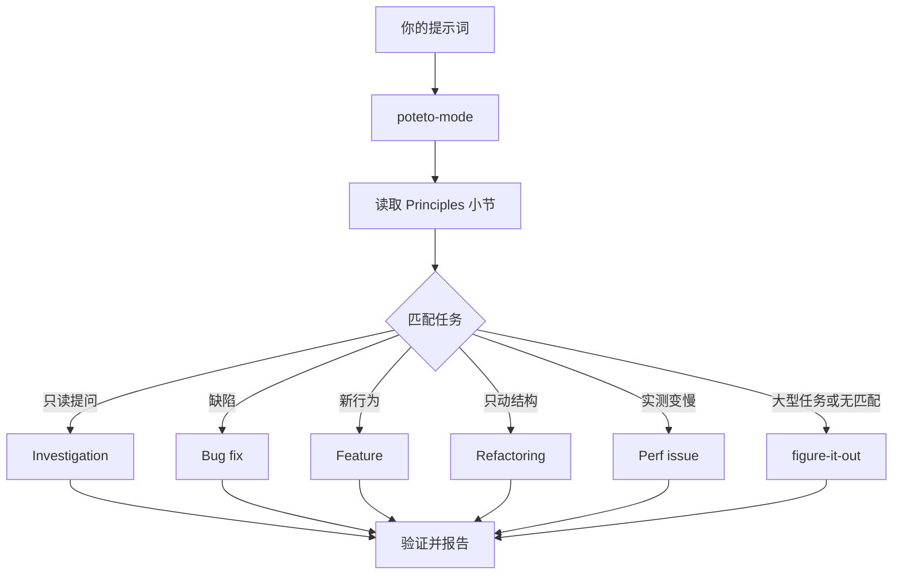

# 用 /poteto-mode 分派任务

`/poteto-mode` 是入口指令。你给它一个目标，它从二十二个 playbook 中匹配一个，把该 playbook 的步骤复制到待办列表，再按每一步的需要调用其他技能。这一页说明好的提示词是什么样的，以及它实际可以有多短。


## 你的提示词会经历什么



图中展示的是常见路线。此外还有这些 playbook：持续优化指标（hillclimbing）、诊断运行时异常、分析已捕获的追踪数据（trace）、构建原型、视觉一致性比对、编写和评测技能、自主运行、提 PR、跟进 PR 或 stack 直到其可合并、落地整个已验证的 stack、无人值守运行 PR 队列或 stack、接手旧会话、安全暂停、多阶段计划，以及清理 worktree。完整清单见 [playbook 目录](../../skills/poteto-mode/playbooks/)。

## 说目标，别写流程排场

不用写需求文档。说清楚哪里出了问题、或者你想要什么，再补上你已经掌握的、能为智能体节省时间的信息：

```text
/poteto-mode 重试之后用户会收到两条通知。先复现，再修复并验证。
```

这是一条 Bug fix 提示词。"先复现"是真实的约束，不是客套话，playbook 会遵守。你会看到待办列表被 Bug fix 的步骤填满。

## 提示词里该写什么

一条有效的提示词最多包含五项内容，每项一句话即可：

- **目标。** 哪里出了问题，或者你想要什么。
- **完成判据。** 必须能判定通过或失败。"改好一点"和"花一小时弄这个"都不算判据。
- **你想看到的证据。** 明确要求真实的命令输出、操作过程的录屏、实际写入的值，或者前后对比的数字。
- **你已经掌握的线索。** 一个症状、一步复现、一行日志或一个链接，都能为智能体省去一轮检索。
- **真正的约束。** "先复现"、"先不要修改任何代码"、"行为零变化"、"继续之前先让我审阅"，每一条都会改变智能体的做法。

五项齐全的一条如下：

```text
/poteto-mode 昨天部署之后，csv 导出会丢掉最后一行。失败的任务 id 是 4812。先复现，再修复。完成的标准是 60k 行的 fixture 每一行都导出。给我修复前后的行数对比。
```

有两项内容反而应该省略：

- **怎么做。** 只说要达成什么，把选择路径的余地留给智能体，它可能找到比你设想更好的方案。技能清单同理，见本页末尾的坑。
- **你对原因的猜测，至少一开始不要给出。** 猜测一旦说出口，排查范围就会被限定在你指向的位置。先让智能体自己复述一遍问题，再给出你的直觉判断。

遇到信息杂乱的报告，比如很长的讨论串或描述含糊的 bug，把复述作为第一步：

```text
/poteto-mode 读一下这个讨论串。用你自己的话、用平实的语言复述底层问题。先不要修改任何代码。
```

理解偏差会在复述中暴露出来，而此时还没有写任何代码。当场纠正只需一条消息，晚了就要付出一次错误修复的代价。只想要复述、不想启动 playbook，就用 [`/in-your-own-words`](../../skills/in-your-own-words/SKILL.md)：它会把智能体理解的目标和要解决的问题原样陈述给你。

拿不准提示词的方向是否正确，发送之前先用 [`/sharpen`](../../skills/sharpen/SKILL.md) 打磨一遍：

```text
/sharpen 为 v2 配置格式写一份迁移指南。
```

智能体会指出四件事：顶尖专家会做、而你没要求的事；他们会从哪些最原始的材料入手；他们会用什么方法和工具；以及除了你和智能体的主观判断，还有什么能证明结果是正确的。然后它据此重写你的提示词——更深入，而不是更庞大。重写版会要求智能体：凡是能用实验确定的选择就先做原型，再基于观察结果给出推荐；产品取向和个人偏好类的选择仍然留给你。它不会直接执行任务。你读一遍重写版，确认合适后再发送，比如交给 `/poteto-mode`。

## 追问可以很短

上下文已经在对话中时，追问可以短到几乎不存在。下面这些都足够：

```text
/poteto-mode 执行吧
```

```text
继续
```

```text
一直执行到完成为止
```

简短之所以可行，是因为流程结构由 playbook 承担，而 Custom Mode 让 `/poteto-mode` 每一轮都留在上下文中。开启方法见[配置 pstack](./01-setup.md#跑第一个任务)。意图由你的话传达，严谨由技能兜底。

## 用 "new task" 切换任务

聊天一长，上一个任务的上下文就会不断累积。切换话题时要明确说明：

```text
/poteto-mode new task. 查清楚为什么退出登录后缓存条目还在。先不要修改任何代码。
```

"new task" 让 `/poteto-mode` 重新匹配 playbook，而不是继续执行上一个；"先不要修改任何代码"把这次锁定在 Investigation。少了这两句，正在执行 Feature 中途的模式，往往会把你的新问题当作功能开发的下一步。

## 并行任务各用一台机器

在一台电脑上对同一个仓库运行多个智能体，它们会争用工作区、端口和构建产物。最干净的隔离是 [cloud subagent](https://cursor.com/docs/subagents#cloud-subagents)：每个子智能体独占一台虚拟机和一个分支，安装依赖、运行应用、录制结果视频都在云端完成，完全不影响你的机器。在任务前输入 `/in-cloud`，或者直接让父聊天把任务分派给云端子智能体。

任务必须留在本地时，一开始就要求一个 worktree：

```text
/poteto-mode new task. 基于 <base> 新建一个 worktree 和分支，然后把解析器的改动移植过去。
```

每个任务独占分支和 worktree，任何智能体都不会覆盖其他智能体的文件。不过 worktree 占用磁盘和机器资源，一台笔记本同时运行不了几个。[Opening a PR playbook](../../skills/poteto-mode/playbooks/opening-a-pr.md) 修改代码本来就默认在 worktree 中进行，所以只有当基线分支或目录位置有特殊要求时，你才需要专门说明。

worktree 会越积越多。磁盘紧张时问一句：

```text
/poteto-mode 是什么占满了我的磁盘？把可以安全清理的 worktree 清理掉。
```

[Worktree cleanup playbook](../../skills/poteto-mode/playbooks/worktree-cleanup.md) 会按合并状态、有无未提交的改动、还有哪些聊天在使用它，对每个 worktree 分类。只删除证据齐全、确认可删的；凡是仍有未提交改动的，都会停下来等你决定。

## 让它自己跑下去

要离开时，把"完成"的标准说清楚，然后即可离开：

```text
/poteto-mode 我要离开一会儿。一直执行到迁移检查报告旧调用方为零为止。记录你的决策。
```

这类事后才审阅的任务会交给 [`/figure-it-out`](../../skills/figure-it-out/SKILL.md)：它先设计整轮运行的阶段，并全程维护一份 [`/show-me-your-work`](../../skills/show-me-your-work/SKILL.md) 决策日志。完整的过夜约定见[睡觉时也让任务继续跑](./07-overnight.md)。

**坑：** 不要在提示词里罗列技能清单（"先 /architect，再 /arena，再 /interrogate……"）。playbook 已经排好了顺序，手写的顺序往往会打乱、甚至遗漏 playbook 本来会执行的步骤。只有想推翻某个具体选择时，才点名技能。

完整的分派规则读 [`poteto-mode`](../../skills/poteto-mode/SKILL.md) 技能本身。

下一步：[先读懂代码，再动手改](./03-understand.md)。
