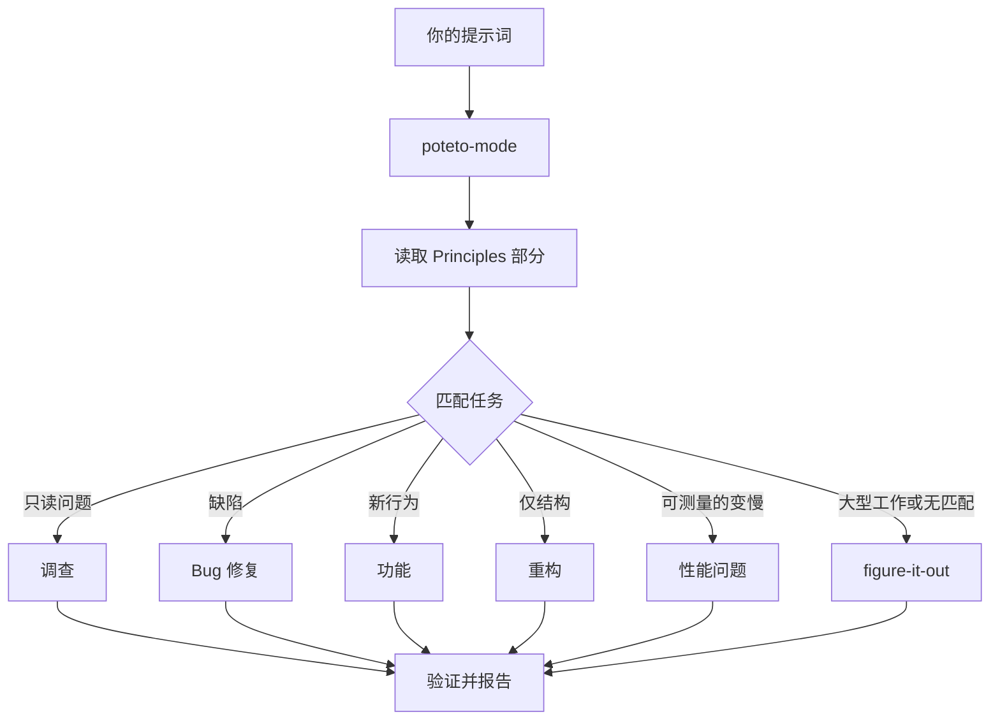

# 通过 `/poteto-mode` 路由工作

`/poteto-mode` 是正门。你给它一个目标，它会匹配二十二个 playbook 中的一个，把那个 playbook 的步骤复制到待办列表里，并在步骤需要时调用其他技能。在这一页中，你将了解一条好提示词长什么样，以及实际上你只需要多短的一条。


## 你的提示词会发生什么



这张图展示了常见的路由。此外还有针对以下场景的 playbook：爬坡优化某个指标、诊断运行时症状和已捕获的 trace、原型、视觉一致性、编写和评估技能、自主运行、提交 PR、把 PR 或 stack 看护到可合并状态、交付一个已验证的 stack、以自动驾驶方式运行 PR 队列或 stack、会话续接、安全暂停、多阶段计划，以及 worktree 清理。[playbook 目录](../../skills/poteto-mode/playbooks/)里有完整集合。

## 说目标，不说仪式

你不写规格说明。你只需说出哪里出了问题或你想要什么，再加上任何你已经知道、能帮智能体省时间的信息：

```text
/poteto-mode users get two notifications after a retry. repro first, then fix and verify.
```

这是一条 Bug 修复提示词。"repro first"（先复现）是真实的约束，不是客套话，playbook 会遵守它。观察待办列表被 Bug 修复的步骤填满。

## 提示词里该放什么

一条有用的提示词最多承载五样东西，每一样都一句话就能说清：

- **目标。** 说出哪里出了问题，或者你想要什么。
- **完成标准。** 它必须能够通过或失败。"让它更好"和"花一个小时做这件事"都不是标准。
- **你想看到的证据。** 要求真实的命令输出、流程的视频、存储的值，或者前后对比的数字。
- **你已经知道的信息。** 一个症状、一个复现步骤、一行日志或一个链接，都能帮智能体省去一次搜索。
- **真实的约束。** "repro first"、"先别改任何代码"、"零行为变化"、"继续之前先让我审阅"，每一条都会改变智能体的行为。

下面是一条五样俱全的提示词：

```text
/poteto-mode the csv export drops its last row since yesterday's deploy. failing job id is 4812. repro first, then fix. done means the 60k-row fixture exports every row. show me the row counts before and after.
```

有两样东西值得省略：

- **怎么做。** 说出要达到什么，给智能体留出空间，让它找到一条比你选的更好的路径。罗列技能清单也一样，见下面的陷阱。
- **你对原因的猜测，至少在最初阶段。** 说出口的猜测会把搜索范围收窄到你指向的地方。在分享你的直觉之前，先让智能体重述问题。

对于一份嘈杂的报告，比如一个很长的讨论串或一个含糊的 bug，把重述作为第一步：

```text
/poteto-mode read this thread. restate the underlying issue in your own words, in plain english. don't change any code yet.
```

误读会在重述中暴露出来，此时还没有任何代码。在那里纠正它，你只花一条消息，而不是一次错误的修复。如果只要重述、不要 playbook，运行 [`/in-your-own-words`](../../skills/in-your-own-words/SKILL.md)。它会重述智能体认为你的目标是什么、你试图解决什么问题。

当你拿不准一条提示词是否瞄准了方向时，在发送之前先用 [`/sharpen`](../../skills/sharpen/SKILL.md) 打磨它：

```text
/sharpen write a migration guide for the v2 config format.
```

智能体会说出：一个顶尖专业人士会做而你却没要求的事、他们会从什么最原始的材料入手、他们会用哪些方法和工具，以及除了你和智能体之外还有什么能证明结果是正确的。然后它会重写你的提示词，精确地要求这些，更深但不大。重写后的提示词会要求智能体对任何能用实验确定的选项先做原型，并从它观察到的情况中推荐一个选项，同时把产品和偏好方面的选择留给你。它不执行任务。读一读重写后的版本，然后发送它，比如用 `/poteto-mode`。

## 简短地跟进

当对话已经承载了上下文时，提示词会缩到几乎没有。下面这些都足够了：

```text
/poteto-mode do it
```

```text
continue
```

```text
keep going until done
```

简短之所以有效，是因为 playbook 承载了结构，而 Custom Mode 让 `/poteto-mode` 在每一轮都保持在上下文中。[安装 pstack](./01-setup.md#运行你的第一个任务)展示了如何开启一个。你的话承载意图，技能承载严谨性。

## 用 "new task" 切换任务

一个长聊天会累积上一个任务的上下文。当你换话题时，要说出来：

```text
/poteto-mode new task. figure out why the cache entry survives logout. don't change any code yet.
```

"new task" 告诉 `/poteto-mode` 重新匹配，而不是继续之前的 playbook。"don't change any code yet" 把这一次锁定为调查。没有这两个短语，一个处于 Feature 中途的模式往往会把你这个问题当作下一个功能步骤。

## 给并行工作各自独立的机器

如果你在一台电脑上对同一个仓库跑多个智能体，它们会争抢工作树、端口和构建产物。最干净的隔离是一个 [cloud subagent](https://cursor.com/docs/subagents#cloud-subagents)。每个都拿到自己的虚拟机和分支，所以它可以安装依赖、运行你的应用、录制结果视频，而不碰你的机器。在任务前输入 `/in-cloud`，或者让父聊天把工作交给云端子智能体。

当工作必须留在本地时，提前要一个 worktree：

```text
/poteto-mode new task. branch off <base> in a fresh worktree, then port the parser change there.
```

每个任务在各自的分支和 worktree 里，意味着没有智能体会踩到另一个的文件。worktree 会消耗磁盘和机器资源，所以一台笔记本电脑一次只能跑几个。[Opening a PR playbook](../../skills/poteto-mode/playbooks/opening-a-pr.md)对代码改动本来就在 worktree 里工作，所以大多数时候只有当你关心特定的基线或位置时才需要这么说。

worktree 会越积越多。当磁盘吃紧时，问：

```text
/poteto-mode what's eating my disk? prune the worktrees that are safe to prune.
```

[Worktree cleanup playbook](../../skills/poteto-mode/playbooks/worktree-cleanup.md) 会根据合并状态、未提交的工作、以及哪些聊天还在碰它，对每个 worktree 分类。它只删除那些有证据明确可以删的，对任何还留着未提交工作的会停下来等你决定。

## 让它继续跑

当你离开时，说清楚"完成"是什么意思，然后走人：

```text
/poteto-mode im stepping away. keep going until the migration check reports zero old callers. log your decisions.
```

你稍后要审阅的工作会走 [`/figure-it-out`](../../skills/figure-it-out/SKILL.md)，它会设计这次运行的阶段，并维护一份 [`/show-me-your-work`](../../skills/show-me-your-work/SKILL.md) 决策日志。[在你睡觉时运行工作](./07-overnight.md)涵盖了完整的过夜契约。

**陷阱：** 不要在提示词里罗列技能（"use /architect, then /arena, then /interrogate..."）。playbook 已经给它们排好了序，而手写的顺序通常会打乱或丢掉 playbook 原本会保留的步骤。只有当你想要覆盖某个具体选择时，才点名技能。

阅读 [`poteto-mode`](../../skills/poteto-mode/SKILL.md) 本身以了解完整的路由规则。

下一步：[理解代码](./03-understand.md)。