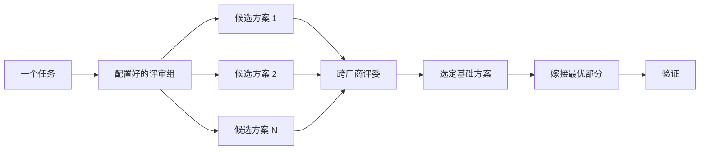

# 写代码之前先定设计

有难度的设计只做一次尝试，等于把模型最先想到的结构固定下来。`/architect` 在实现之前先敲定类型和边界。`/arena` 让同一份任务说明跑多次尝试，再合并各自最好的部分。`/interrogate` 让其他模型尝试攻破产出的结果。当任务要的是覆盖面而不是综合设计时，`/swarm` 铺开切片或竞速，再汇总结果。

设计阶段最常见的两个错误：直接采纳智能体的第一版设计，以及打磨一份还没被任何代码检验过的计划。这一页把两个问题都解决。你用代码来做规划。原型回答悬而未决的问题，README 或教程定下目标，书面计划最后才写。


## 用 /architect 定结构

```text
/architect design the import pipeline before writing any code. i care most about how callers use it.
```

[`/architect`](../../skills/architect/SKILL.md) 先把这次改动触及的每个系统追查一遍，然后勾勒两种不同的结构，各自带类型、签名和模块边界，再按三条标准选择一个：每份状态只有一个所有者，每项任务只有一种做法，调用方需要了解的细节最少。遇到规模大或有争议的设计，它会改为运行 `/arena`，而不是独自绘制草图。想在写任何代码之前先看到设计，就在提示词里明确说明。

代码开始编写后，设计并非不可更改。同一种变通做法反复出现时，`/architect` 会重新设计，而不是绕着问题打补丁。

## 用 /arena 并行试多个方案

```text
/arena take my prompt to the arena verbatim. i want to compare their proposals with yours.
```

[`/arena`](../../skills/arena/SKILL.md) 是底层的通用工具。N 个子智能体并行尝试同一份设计或编码任务说明，各自写入独立的 worktree 或目录。一位来自其他模型厂商的只读评委，按评分标准给每个候选方案打分。没有其他厂商的模型可用时，协调者智能体会跳过评委，自行选择基础方案。协调者智能体把每个候选方案从头到尾读完，选定一个作为基础，把落选方案中最好的想法嫁接进来，最后验证结果。



评审组来自你的 [`/setup-pstack`](../../skills/setup-pstack/SKILL.md) 配置，可以按任务调整。决策重要时多要几个候选方案，不重要时少要几个：

```text
/arena this, 5 candidates. the cache key format is expensive to change later.
```

## 用 /swarm 铺开切片和竞速

```text
/swarm check every package under packages/ against its check.sh. one worker per package. one report.
```

[`/swarm`](../../skills/swarm/SKILL.md) 把 N 个 worker 分配到相互独立的切片、覆盖矩阵、关卡式检查通道、探索分区，或事先声明的竞速分支上。每个 worker 领到自己的范围和检查，然后报告 `PASS`、`ISSUES` 或 `BLOCKED`。父智能体等待所有 worker 完成，汇总成一份紧凑报告，注明缺口和未能完成的任务。

并行能换来覆盖面，或能让相互独立的检查竞速时，就用它。`/arena` 给每个 worker 同一份设计或编码任务说明，然后选择基础方案、嫁接最好的部分。`/swarm` 覆盖切片，或运行一场事先声明了选择规则的竞速。它不走选择基础方案再嫁接的那套流程。

## 用 /interrogate 做对抗性审查

```text
/interrogate the whole branch, but skeptically. no nitpicks unless it's an actual bug or regression.
```

[`/interrogate`](../../skills/interrogate/SKILL.md) 把改动及其意图交给运行在你所配置模型上的对手，每个对手都对真实代码实际运行一遍，试图将其攻破。不同对手找到的失败各不相同。只有重新运行对应命令、确实出现破坏意图的失败，一条发现才算成立。报告会列出每条验证过的发现、由哪些对手找到，再列出每个对手丢弃了什么、为什么丢弃，但不应用任何改动。

Dropped（已丢弃）列表也要读。你可以推翻它的结论。

## 用原型代替争论

永远不要直接采纳第一版设计。多要几版，从可见的证据中选择：

```text
/poteto-mode prototype a few options for the new dropdown menu. take screenshots or videos for me to compare.
```

[Prototype playbook](../../skills/poteto-mode/playbooks/prototype.md) 在临时目录里构建一批一次性原型草稿，把各变体挂在同一个切换器后面，逐个运行，采集截图或计时数据。不只是 UI，行为和算法同样适用。原型就是用代码做规划。智能体通过实际运行验证就能自行回答悬而未决的问题，无需询问你；这也为你原本想不到的选项留出了空间。

同样的思路可以放大到正式设计。把 `/architect` 和原型搭配使用，并留一道评审关卡：

```text
/poteto-mode we need rate limiting for external webhooks. /architect it first, and answer open questions with prototypes. let me review before proceeding.
```

不要把对手消耗在一份抽象计划上。`/interrogate` 会丢弃所有无法通过运行取证的发现，一份没有代码支撑的计划几乎没有可攻破之处。让原型把问题确定下来，再评审实际构建出的成果。

## 共享代码先写 README

要被其他代码调用的包或 API，先写用户会读的那份文档：

```text
/poteto-mode write a tutorial for how i would use the new config package first. then /teach me why it beats the current one.
```

先写教程，迫使你站在调用方的视角。向一位假想用户描述这个 API，再倒推回实现。这份文档也成了具体目标，智能体据此核对自己的工作。文档本身重要时，点名 [`/technical-writing`](../../skills/technical-writing/SKILL.md)，让教程保持教程的定位，不至于同时滑向参考手册与原理解释。

## 设计定了再写计划

pstack 有意不提供规划技能。确实需要一份书面计划时，等设计确定后再提出：

```text
/poteto-mode turn this design into a plan. small verifiable PRs, each with its own verification steps.
```

[Multi-phase plan playbook](../../skills/poteto-mode/playbooks/multi-phase-plan.md) 先用原型解决剩下的开放问题，再按 PR 逐个编写小节，每节都以改动确实有效的证据收尾。仅测试套件通过，不算这种证据。计划本身就是交付物。这个 playbook 不负责实现，只有你明确说开始才会执行。

做迁移时，在提示词里写明验收标准：

```text
/poteto-mode plan the migration of our ui library to the new styling system. small verifiable PRs, each with visual regression checks. the result must match the original exactly, bugs included.
```

"bugs included" 是为了防止迁移途中顺带悄悄修复一些问题——那样新旧输出就无法对比。跨多天的项目，可以把计划暂时提交进仓库，让其他智能体看到进行中的工作。工作合并落地后删除。

## 一个任务该做多少设计

你可能想问：每个改动都需要这一整套吗？不需要。大多数改动一项都不需要。大致分为以下几档：

- 小而完整、但你没有把握的改动，只需要 `/interrogate`。
- 跨越函数边界或转移所有权的改动，值得使用 `/architect`；设计规模大或有争议时，它会连带运行 `/arena`。
- 独立尝试有帮助的单个决策，比如命名、格式或算法，直接使用 `/arena`。
- 覆盖矩阵、一组并行检查，或声明了各条分支的竞速，用 `/swarm`。
- 通过实际运行验证就能回答的开放问题，比如布局、耗时或某个做法，做原型，不要争论。
- 有争议、返工代价又高的设计，先 `/architect`，交付前再 `/interrogate`。
- 横跨多个 PR 的工作要写计划，等设计确定后再写。

`/poteto-mode` 已经在按这套分档执行。跨边界的工作会自动触发 `/architect`，所以你直接点名这些技能，主要是想要比默认更多或更少的审查力度。

下一步：[实现改动，收拾 diff](./05-build-and-clean.md)。
