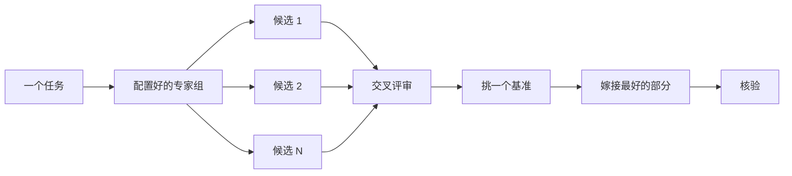

# 写代码之前先做设计

只尝试一次困难的设计，会把模型最先想到的那个形状锁死。`/architect` 在实现之前先敲定类型和边界。`/arena` 对同一份任务书跑多次尝试，再合并最好的部分。`/interrogate` 让其他模型去试着攻破结果。当任务是覆盖率而非设计综合时，`/swarm` 把切片或竞速铺开，再聚合它们的结果。

两种最常见的设计错误是：照单全收智能体的第一个设计，以及打磨一份还没有任何代码检验过的计划。这一页把两个都修掉。你通过代码来规划。原型回答那些悬而未决的问题，一份 README 或教程设定目标，而书面计划最后才写。


## 用 `/architect` 敲定形状

```text
/architect design the import pipeline before writing any code. i care most about how callers use it.
```

[`/architect`](../../skills/architect/SKILL.md) 会先追踪这次改动触及的每一个系统。然后它勾勒出两种不同的形状，每一种都带类型、签名和模块边界，并挑出那个"每一份状态只有一个主人、每一个任务只有一种做法、调用方需要知道得最少"的方案。对于大型或有争议的设计，它会去跑 `/arena`，而不是独自勾勒。如果你想在任何代码之前先看到设计，就在提示词里说出来。

一旦代码开始，设计就不再神圣。如果同一个 workaround 反复冒出来，`/architect` 会重新设计，而不是绕着它打补丁。

## 用 `/arena` 铺开多次尝试

```text
/arena take my prompt to the arena verbatim. i want to compare their proposals with yours.
```

[`/arena`](../../skills/arena/SKILL.md) 是底层的通用工具。N 个子智能体并行地尝试同一份设计或代码任务书，各自写进自己的 worktree 或目录。一位来自不同模型厂商的只读评委，依照一份评分标准给每个候选打分。当没有其他厂商的模型可以运行时，协调者会跳过评委、自己挑选基准。协调者把每个候选从头到尾读一遍，挑出一个基准，把落选者最好的想法嫁接进去，再核验结果。



专家组来自你的 [`/setup-pstack`](../../skills/setup-pstack/SKILL.md) 配置，你可以按任务调整它。决策重要时多要几个候选，不重要时少要几个：

```text
/arena this, 5 candidates. the cache key format is expensive to change later.
```

## 用 `/swarm` 覆盖切片与竞速

```text
/swarm check every package under packages/ against its check.sh. one worker per package. one report.
```

[`/swarm`](../../skills/swarm/SKILL.md) 把 N 个 worker 铺到相互独立的切片、覆盖率矩阵、闯关赛道、探索分区，或事先声明的竞速分支上。每个 worker 拿到自己的范围和检查项，然后报告 `PASS`、`ISSUES` 或 `BLOCKED`。父节点等待所有 worker，返回一份带缺口和掉队情况的紧凑报告。

当并行能换来覆盖率、或能让相互独立的检查竞速时，就去找它。`/arena` 给每个 worker 同一份设计或代码任务书，然后挑基准、嫁接最好的部分。`/swarm` 覆盖切片，或跑一场事先声明了选择规则的竞速。它不用那套挑基准加嫁接的仪式。

## 用 `/interrogate` 攻破它

```text
/interrogate the whole branch, but skeptically. no nitpicks unless it's an actual bug or regression.
```

[`/interrogate`](../../skills/interrogate/SKILL.md) 把改动及其意图交给配置好的模型上的对手，每一个都试着对着真实代码跑一遍来攻破它。对手会发现不同的失败。只有当重跑它的命令能显示出破坏意图的失败时，一条发现才算成立。报告列出每一条被核验过的发现及其找到它的对手，然后是每个对手放弃的东西及原因，并且什么都不应用。

也要读一读 Dropped 列表。你可以推翻那个裁决。

## 用原型代替争论

绝不要照单全收第一个设计。要几个，再从你能看到的证据里挑：

```text
/poteto-mode prototype a few options for the new dropdown menu. take screenshots or videos for me to compare.
```

[Prototype playbook](../../skills/poteto-mode/playbooks/prototype.md) 在一个临时目录里搭建一次性的草图，把各个变体放到一个切换器后面，逐个驱动，并抓取截图或计时。它同样适用于行为和算法，不只是 UI。原型就是用代码做规划。它们让智能体通过跑点东西来回答自己的开放问题，而不是来问你，并且给一个你没想到的选项留出了空间。

同样的思路可以放大到真正的设计。把 `/architect` 和原型配对，并保留一道审阅关卡：

```text
/poteto-mode we need rate limiting for external webhooks. /architect it first, and answer open questions with prototypes. let me review before proceeding.
```

别把对手浪费在一份抽象计划上。`/interrogate` 会丢掉每一条跑一遍无法证明的发现，所以一份背后没有代码的计划，几乎没什么可攻破的。让原型去敲定问题，然后审阅造出来的东西。

## 共享代码先写 README

对于一个其他代码会使用的包或 API，从用户会读的那份文档开始：

```text
/poteto-mode write a tutorial for how i would use the new config package first. then /teach me why it beats the current one.
```

先写教程会逼出调用方的视角。你向一个假想的用户描述这个 API，再倒推回实现。这份文档也成了一个具体的目标，让智能体拿来核对自己的工作。当文档本身重要时，点名 [`/technical-writing`](../../skills/technical-writing/SKILL.md)，这样教程就还是教程，而不是同时漂成参考和解释。

## 设计敲定之后再写计划

pstack 没有规划类技能，这是刻意的。当你确实想要一份书面计划时，等设计敲定了再要：

```text
/poteto-mode turn this design into a plan. small verifiable PRs, each with its own verification steps.
```

[Multi-phase plan playbook](../../skills/poteto-mode/playbooks/multi-phase-plan.md) 用原型敲定剩余的任何开放问题，然后每个 PR 写一节，每一节都以"改动确实有效"的证明收尾。光有一套通过的测试套件不算那种证明。计划就是交付物。这个 playbook 不去实现它，只有等你说"开始"才执行。

对于一次迁移，在提示词里说清楚标准：

```text
/poteto-mode plan the migration of our ui library to the new styling system. small verifiable PRs, each with visual regression checks. the result must match the original exactly, bugs included.
```

"bugs included" 让迁移不至于在路上悄悄修掉一些东西——那会让新旧输出无法对比。对于一个跨越多天的项目，你可以把计划提交到仓库里放一阵子，好让其他智能体看到进行中的工作。等工作落地后再删掉它。

## 一个任务该做多少设计？

你可能在想，是不是每个改动都需要这些。不是。大多数改动一样都不用。一个粗略的阶梯：

- 一个你拿不准的小而完整的改动，只需要 `/interrogate`。
- 一个跨越函数边界或转移所有权的改动，值得 `/architect`——当设计大或有争议时，它会顺带把 `/arena` 带来。
- 一个独立决策、且独立尝试会有帮助的场景，比如命名、格式或算法，直接上 `/arena`。
- 一张覆盖率矩阵、一组并行检查，或一场声明了分支的竞速，用 `/swarm`。
- 一个你跑点东西就能回答的开放问题，比如布局、计时或某个做法，用原型，而不是争论。
- 一个有争议、且逆转成本高的设计，先 `/architect`，发布前再 `/interrogate`。
- 跨越多个 PR 的工作，在设计敲定后写一份计划。

`/poteto-mode` 已经在应用这个阶梯。跨边界的工作会自己触发 `/architect`，所以你直接去找这些技能，主要是在你想要比默认更多或更少审视的时候。

下一步：[构建并清理改动](./05-build-and-clean.md)。