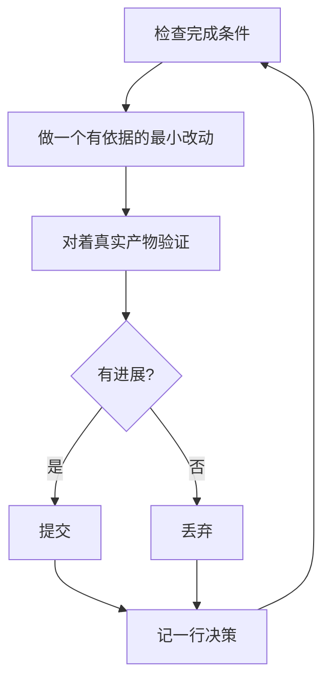

# 在你睡觉时运行工作

这是前面所有内容的回报。一个你能信任它会核验自己工作的智能体，是一个你可以独自留下、交给它一个硬任务的智能体。让这件事变安全的不是希望，而是一个可检查的完成条件、一个隔离的 worktree 或云端智能体，以及一份你早上要审计的决策日志。


## 在进入循环之前先赢得信任

一个你不信任的循环，只会更快地产出未经检查的工作，而烂摊子会随着每一次迭代而加重。在你留下一个循环运行之前，先确认它已经赢得了这份信任：

- 你已经亲手做过一次这个任务，或看过一个智能体做过，所以你知道"好"长什么样。
- 智能体拥有你自己会用的工具和信号：验证技能、剖析器、日志。
- 每一个阶段都证明自己的工作，并且当工作不达标时能停下整条线。
- 你读过几份记录，并把反复出现的失败转化成了工具、技能或检查。

只有这四条都成立，才让循环自主运行。在那之前，边看边跑。

## 过夜契约

一个好的交接要有目标、完成条件、权限，以及一个逃生舱口。它不必长：

```text
/poteto-mode im going to bed. migrate every caller to the new parser in a fresh worktree off <base>.
done means zero old callers, all parser fixtures pass, old api deleted.
keep a decision log. don't ask me before committing.
/loop until done. if you're truly stuck after a few hours, stop and write up why.
```

逐行看看每一句买到了什么：

- "im going to bed" 是一次会话覆盖。智能体停止询问，继续前进。
- "done means..." 把目标变成每一次迭代都能跑的检查。
- "fresh worktree off `<base>`" 让这次运行不和你打开的任何其他东西相撞。
- "don't ask me before committing" 预先回答了智能体原本会卡住的权限问题。
- `/loop` 是 Cursor 内置的唤醒机制，不是 pstack 技能。[Autonomous run playbook](../../skills/poteto-mode/playbooks/autonomous-run.md) 用它来在事件或心跳上重新检查完成条件。
- 逃生舱口让它在真正的死胡同处停下并写下原因，这胜过八小时创造性地重新解释目标。

因为你会在离开后审阅这份工作，`/poteto-mode` 会把它路由到 [`/figure-it-out`](../../skills/figure-it-out/SKILL.md)，后者在任何代码之前先设计这次运行的阶段，并接好决策日志。

要有意地停掉一次运行，就告诉智能体暂停，或告诉它你即将离线或重启 Cursor。[Pause safely playbook](../../skills/poteto-mode/playbooks/pause-safely.md) 会完成或退出当前步骤，提交一个进行中的检查点，并写一份续接笔记。一个新的聊天会通过 Session pickup playbook 从那份笔记接手工作。说"keep going"绝不会触发暂停。

## 循环整晚都在做什么



每一次迭代：一个改动、一次检查、一行日志。没起作用的改动被丢弃，而不是留着继续。一个平台期意味着转向，而不是停下，而完成条件绝不会悄悄放松来宣布胜利。

## 早上的审计

[`/show-me-your-work`](../../skills/show-me-your-work/SKILL.md) 是让这次运行变得可审阅的东西。每一行记录时间、阶段、决策、原因、一个证据指针和结果，存在 `decisions.tsv` 的 TSV 里（当几次运行共享一个目录时，存在 `.audit/<task-slug>.tsv`）。它默认留在本地。当工作足够宏大、审阅者需要这条线索才能信任结果时，提交它。

当你回来时，用审阅的形式要这次运行：

```text
/show-me-your-work catch me up on what you did last night
```

在这个技能交回它的摘要之前，它会生成一个不同模型家族的审阅者，去读那条线索和记录，而回复会以一个 Attention 部分收尾，列出哪些值得你审视。先读那一部分，再读它指向的日志行。你审计的是决策，不是重读整个晚上。

想要一个快速状态而不是审计，就在跑这份工作的那个聊天里运行 [`/ketchup`](../../skills/ketchup/SKILL.md)。它只读，并用大白话告诉你自你上一条消息以来发生了什么变化，带着这份工作产出的截图和小图。然后它列出每一个在等你的调用，比如一次合并、一次批准，或选项之间的一个选择，带上它的选择、证据和风险，这样你光看回复就能做决定。

## 当夜晚装的是一个队列，而不是一个任务

上面这份契约把一个任务驱动到一个完成条件。有些夜晚装得更多：一队相互独立的改动，或一整个项目。两个 playbook 加一个技能，把同样的信任放大上去。

[Autopilot-full](../../skills/poteto-mode/playbooks/autopilot-full.md) 把一队相互独立的 PR 跑到合并。每个 PR 有一个主人智能体，把它从构建一路带到合并，而且没有任何主人会凭自己的裁决合并。一群全新的验证者检查主人那个代码就绪的头。之后的一次变基或小修，只用一个全新的验证者，而只有新行为或一个大的新 diff 才会再次调用完整的群。只有对那个将要合并的补丁给出干净的裁决，才授权合并：

```text
/poteto-mode full autopilot on this queue. each item is independent. i want them merged by morning.
```

[Autopilot-stack](../../skills/poteto-mode/playbooks/autopilot-stack.md) 是没有合并的 Autopilot-full。你醒来时看到已验证的 PR，每个都带着它的裁决，你自己审阅并落地它们。一个 PR 只堆叠在它所依赖的那个 PR 上。当你想在任何东西合并之前亲眼看看这份工作时，选它而不是 Autopilot-full：

```text
/poteto-mode autopilot these five changes, but don't merge. i'll land them in the morning.
```

一个完整的项目，比如一次跨许多包的迁移，没有它自己的 playbook。`/poteto-mode` 会把大型或跨领域的工作路由到 [`/figure-it-out`](../../skills/figure-it-out/SKILL.md)，后者为它设计一次严谨的运行：

```text
/poteto-mode migrate every package to the new store. own it until each one is converted and merged. i'll check in twice a day.
```

## 并行跑许多项目

一个 [Cursor Project](https://cursor.com/blog/projects) 给一个协调者智能体一个持久的线程。协调者不写代码。它指挥子智能体，子智能体默认在云端运行，所以当你合上笔记本时工作仍在继续。你发给协调者的提示词以 `/poteto-mode` 开头，而它生成的子智能体会遵循 playbook。它启动的每个智能体都会先读 [`worker.md`](../../skills/poteto-mode/worker.md)，这样 worker 就能守住启动时的标准、决定可逆的调用而不是来问你，并打开就绪待审的 PR。

几个习惯会有帮助：

- 给每一块工作一个自己的 Project，比如一个功能、一次迁移、一次性能冲刺，或一次技术债清理。几个可以并排跑。
- 把相关的聊天拖进 Project，包括已完成的那些。它们会成为其中每个智能体的上下文。
- 在每个 PR 合并前给它一个验证群，并让 Autopilot-stack 或 Autopilot-full 去带这个队列。
- 向协调者要一份有数据支撑的计划，并让它在问你之前先用原型回答开放问题。

一条提示词就能带起一整个 Project，从研究到执行：

```text
/poteto-mode refactor this repo so its architecture is more agent friendly. use /correct and /architect on past commits and review comments to find the mistakes agents make most here. use /recall for context from past chats. answer open questions with prototypes instead of asking me. come back with a plan backed by real data. once i approve it, run it with autopilot-stack or autopilot-full, and ask me which.
```

## 让循环自己启动

上面每一个循环仍然在等你启动它。一个定时或事件驱动的自动化会去掉这一步。软件维护会拆成几个很适合这种方式的阶段：分类一个报告、复现它、修它、验证这个修复。两条规则让这样一条线值得信赖：

- 每个阶段都能停下整条线。分类可以判定这个报告是预期行为，复现可以复现不出来，修复者可以判定这个改动风险太高。每一个这样的结果都有用，因为它阻止坏工作流到下一个阶段——在那里撤销的成本更高。
- 每个阶段都交接证据。复现附上坏状态的截图和视频，修复附上前后对比的证明。然后一个人就能在读到一行代码之前，先检查智能体修对了东西。

pstack 把这件事作为一个休眠的[自动化包](../../automations/benny/README.md)随附，用于 Slack issue 报告。一个自动化分类每份报告。另一个复现已确认的 bug，并可能准备一个小型草稿修复。把一个智能体指向它的 [`FOR_AGENTS.md`](../../automations/benny/FOR_AGENTS.md)，并说出目标仓库，就能把它搭起来。

**陷阱：** 一个时长不是完成条件。"work on this for 4 hours" 给智能体的东西无可检查，你会醒来看到四小时的动作，而不是一个结果。给 `/loop` 一个能通过或失败的谓词。

下一步：[用原则名来掌舵](./08-principles.md)。