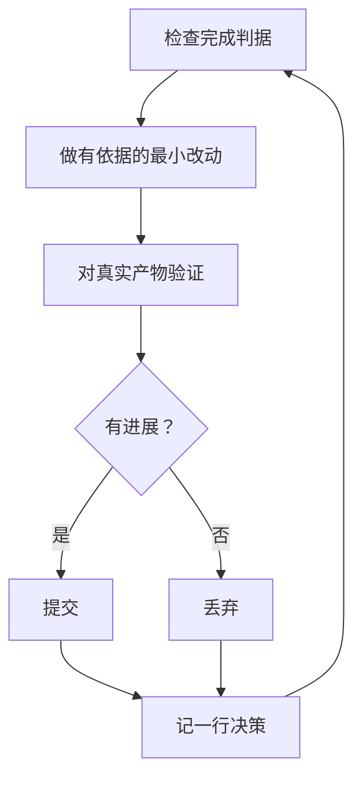

# 睡觉时也让任务继续跑

前面所有铺垫，回报就在这里。一个能放心让它自行验证工作的智能体，才是一个能独立承担高难度任务的智能体。让这件事安全的不是侥幸心理，而是可检查的完成判据、隔离的 worktree 或云端智能体，外加一份你早上要审计的决策日志。


## 先建立信任，再交给循环

不信任的循环只会更快地产出未经检查的工作，问题随迭代不断累积。让循环无人值守运行之前，先确认它值得这份信任：

- 这个任务你亲手做过一次，或看智能体做过，知道"好"是什么样。
- 你自己会用的工具和信号，智能体都有：验证技能、性能剖析器、日志。
- 每个阶段都能证明自己的工作，工作不达标时能停止整条流水线。
- 你读过几份会话记录，把反复出现的失败转化成了工具、技能或检查。

四条全部成立，才让循环自主运行。在此之前，在旁观察运行。

## 过夜约定

一份好的交接要有目标、完成判据、权限和一个退出机制，不必写很长：

```text
/poteto-mode im going to bed. migrate every caller to the new parser in a fresh worktree off <base>.
done means zero old callers, all parser fixtures pass, old api deleted.
keep a decision log. don't ask me before committing.
/loop until done. if you're truly stuck after a few hours, stop and write up why.
```

逐行看每一行分别换来什么：

- "im going to bed" 是会话级的覆盖指令：智能体不再询问，持续执行。
- "done means..." 把目标变成每轮迭代都能运行的检查。
- "fresh worktree off `<base>`" 让这轮运行不与你正在进行的任何其他工作冲突。
- "don't ask me before committing" 预先批准了那个原本会让智能体阻塞的权限。
- `/loop` 是 Cursor 内置的唤醒机制，不是 pstack 技能。[Autonomous run playbook](../../skills/poteto-mode/playbooks/autonomous-run.md) 靠它在事件或心跳到来时重新检查完成判据。
- 退出机制让它能在真正陷入僵局时停下、写清原因，好过花八个小时反复重新解读目标。

因为这些工作要等你离开之后再审阅，`/poteto-mode` 会把它交给 [`/figure-it-out`](../../skills/figure-it-out/SKILL.md)：编写任何代码之前先设计好整轮运行的阶段，并接入决策日志。

想主动停止一轮运行，就告诉智能体暂停，或说明你即将下线、要重启 Cursor。[Pause safely playbook](../../skills/poteto-mode/playbooks/pause-safely.md) 会完成或回退当前步骤，提交一个进行中的检查点，写一份续接笔记。新开的聊天通过 Session pickup playbook 从这份笔记接手。说"keep going"绝不会触发暂停。

## 循环整晚在做什么



每轮迭代：一次改动、一次检查、一行日志。没有效果的改动直接丢弃，不让它混入后续流程。进入停滞期就调整方向，而不是停止；完成判据也绝不会为了宣布完成而悄然放宽。

## 早上做审计

[`/show-me-your-work`](../../skills/show-me-your-work/SKILL.md) 让整轮运行变得可审阅。每行记录时间、阶段、决策、理由、证据指针和结果，存成 `decisions.tsv` 这份 TSV（几轮运行共用一个目录时，存到 `.audit/<task-slug>.tsv`）。默认只留在本地。工作规模足够大、评审者需要这条轨迹才能信任结果时，再把它提交进仓库。

回来之后，索取一份可审阅的运行汇报：

```text
/show-me-your-work catch me up on what you did last night
```

技能交回摘要之前，会先派一个不同模型家族的评审智能体，通读决策轨迹和会话记录；回复以 Attention 小节收尾，列出值得你重点审视的内容。先读这一节，再读它指向的日志行。你审计的是决策，不是把一整晚重读一遍。

只想快速了解状态、不做审计，就在执行这项工作的那个聊天里运行 [`/ketchup`](../../skills/ketchup/SKILL.md)。它只读不写，用平实的语言说明你上一条消息之后有什么变化，附上工作产出的截图和小图。然后逐条列出等你决定的事项——合并、批准、或在几个选项里选择——每条都附它的建议、证据和风险，仅凭回复就能做决定。

## 一整晚要跑的是一个队列，而不是一个任务

上面这份约定针对的是一个任务、一个完成判据。有些晚上要完成的更多：一批相互独立的改动排成的队列，甚至一整个大项目。两个 playbook 加一个技能，把同样的信任放大到这个规模。

[Autopilot-full](../../skills/poteto-mode/playbooks/autopilot-full.md) 把一个相互独立的 PR 队列推进到全部合并。每个 PR 有一个负责智能体，从构建一路负责到合并，但任何负责智能体都不能凭自己的结论合并。一批全新的验证 worker 检查负责智能体交出的、已达代码就绪状态的 head。之后的变基或小修只派一个全新的验证 worker；只有出现新行为或很大的新 diff，才再次动用整批 swarm。只有对最终要合并的那份补丁给出干净结论，才授权合并：

```text
/poteto-mode full autopilot on this queue. each item is independent. i want them merged by morning.
```

[Autopilot-stack](../../skills/poteto-mode/playbooks/autopilot-stack.md) 就是去掉合并的 Autopilot-full。醒来看到的是一批已验证的 PR，各带结论，由你自己审阅、自行落地。PR 只堆叠在它真正依赖的 PR 上。想在任何合并发生之前亲自审阅一遍工作，就选它，而不是 Autopilot-full：

```text
/poteto-mode autopilot these five changes, but don't merge. i'll land them in the morning.
```

一整个项目计划，比如横跨许多包的迁移，没有专属 playbook。`/poteto-mode` 会把大型或横切多处的工作交给 [`/figure-it-out`](../../skills/figure-it-out/SKILL.md)，由它设计一轮严谨的运行：

```text
/poteto-mode migrate every package to the new store. own it until each one is converted and merged. i'll check in twice a day.
```

## 多个项目并行跑

一个 [Cursor Project](https://cursor.com/blog/projects) 给一个协调者智能体一条持久的会话线程。协调者不写代码，只指挥子智能体；子智能体默认在云端运行，合上笔记本工作也不中断。发给协调者的提示词以 `/poteto-mode` 开头，它派出的子智能体就会遵循 playbook。它启动的每个智能体都先读 [`worker.md`](../../skills/poteto-mode/worker.md)，于是 worker 会坚持任务启动时定下的标准、可逆的决定自行做出而不询问你，提出的 PR 可直接评审。

几个习惯很有用：

- 每块工作单开一个 Project：一个功能、一次迁移、一轮性能攻坚、一次技术债清理，几个可以同时运行。
- 把相关聊天拖进 Project，已完成的也包括在内。它们会成为 Project 里每个智能体的上下文。
- 每个 PR 合并前都经过一轮验证 swarm，队列交给 Autopilot-stack 或 Autopilot-full 推进。
- 向协调者索取有数据支撑的计划，悬而未决的问题让它先用原型回答，而不是急于询问你。

一条提示词就能带动一整个 Project，从调研到执行：

```text
/poteto-mode refactor this repo so its architecture is more agent friendly. use /correct and /architect on past commits and review comments to find the mistakes agents make most here. use /recall for context from past chats. answer open questions with prototypes instead of asking me. come back with a plan backed by real data. once i approve it, run it with autopilot-stack or autopilot-full, and ask me which.
```

## 让循环自己启动

上面的每个循环都还等你手动启动。定时或事件驱动的自动化省去了这一步。软件维护天然拆成很适合这种方式的几个阶段：分类甄别（triage）报告、复现、修复、验证修复。两条规则让这条流水线可靠：

- 每个阶段都能停止流水线。分类甄别可以判定报告属于预期行为，复现可能无法复现，修复者可以判定改动风险太高。这些结果都有价值：不合格的工作被挡在下一阶段之外，而越往后，撤销的代价越大。
- 每个阶段都交接证据。复现附上故障状态的截图和视频，修复附上前后对比的证据。这样人不看一行代码，也能先确认智能体修复的是正确的问题。

pstack 自带一个默认休眠的[自动化包](../../automations/benny/README.md)，面向 Slack 上的 issue 报告：一个自动化对每份报告做分类甄别，另一个复现已确认的 bug，还可能准备一份小的草稿修复。让智能体读它的 [`FOR_AGENTS.md`](../../automations/benny/FOR_AGENTS.md)、指明目标仓库，即可完成配置。

**坑：** 时长不是完成判据。"work on this for 4 hours" 没有给智能体任何可检查的条件，醒来看到的是四个小时的忙碌，不是结果。给 `/loop` 一个能判定通过或失败的谓词。

下一步：[用原则名给智能体纠偏](./08-principles.md)。
